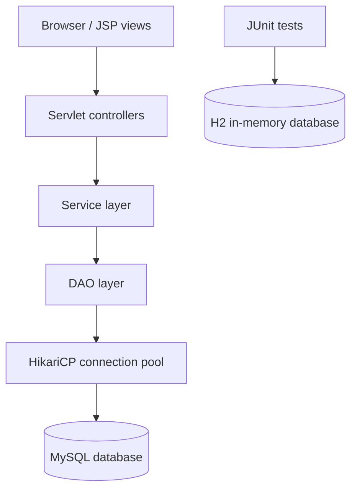

# Airport Lounge Manager

A Java 17 web application for managing airport lounge operations, passenger records, access requests, lounge data, transactions, and staff workflows.

## Technology stack

| Layer | Technologies |
|---|---|
| Language/runtime | Java 17 |
| Web layer | Java Servlets (`javax.servlet` 3.1), JSP, JSTL |
| Build | Maven, WAR packaging |
| Database | JDBC, MySQL Connector/J |
| Connection pooling | HikariCP |
| Test database | H2 in-memory database |
| Testing | JUnit 4 |
| Supporting libraries | Gson, ZXing (QR processing), webcam-capture |
| Local web container | Embedded Cargo/Tomcat 9 configuration |

## Architecture

The source is organized around a servlet/controller, service, DAO, model, and utility structure:



Representative controller areas include login/logout, dashboard, airports, lounges, passengers, access requests/providers, notifications, reports, settings, status, transactions, and user management. Persistence is separated into DAO classes.

## Repository layout

- `src/main/java/com/alm/controller/` — servlet endpoints/controllers
- `src/main/java/com/alm/service/` — business logic
- `src/main/java/com/alm/dao/` — JDBC data-access classes
- `src/main/java/com/alm/model/` — domain models
- `src/main/java/com/alm/config/` — role and permission model
- `src/main/java/com/alm/filter/` — request filters, including authentication filtering
- `src/main/java/com/alm/util/` — database and password utilities
- `src/main/webapp/` — JSP views and web assets
- `src/main/resources/` — resource/configuration templates
- `src/test/java/` — JUnit tests, including H2-backed DAO/auth tests
- `pom.xml` — Maven dependencies and build configuration

## Prerequisites

- JDK 17
- Maven 3.8+
- MySQL 8.x (for a MySQL-backed local run)
- A database named `alm`
- Tomcat 9 for manual WAR deployment, or use the configured Cargo run target

## Database configuration

The application reads database configuration in this order:

1. Environment variables: `DB_URL`, `DB_USER`, `DB_PASSWORD`, `DB_DRIVER`
2. JVM system properties: `db.url`, `db.user`, `db.password`, `db.driver`
3. Optional classpath `/db.properties`
4. Development fallback values in `DBConnection`

For local development, create a dedicated MySQL user with only the privileges the application needs. Do not use the MySQL root account or a blank password outside an isolated local environment.

Example PowerShell session:

```powershell
$env:DB_URL = "jdbc:mysql://localhost:3306/alm"
$env:DB_USER = "alm_app"
$env:DB_PASSWORD = "replace-with-a-local-secret"
$env:DB_DRIVER = "com.mysql.cj.jdbc.Driver"
```

Alternatively, copy `src/main/resources/db.properties.example` to a local `db.properties` on the classpath and fill in local values. Do not commit real credentials.

Create the `alm` database and apply the schema supplied with the project before starting the application. Confirm that the schema matches the DAO queries in the current branch.

## Run locally

### Option 1: Maven + embedded Cargo/Tomcat

From the repository root:

```bash
mvn clean package
mvn cargo:run
```

Open:

`http://localhost:8080/airport-lounge-manager`

### Option 2: Build a WAR for Tomcat

```bash
mvn clean package
```

Copy `target/airport-lounge-manager.war` into the Tomcat 9 `webapps/` directory, start Tomcat, and open the application context path.

The project uses the `javax.servlet` API and the Maven Cargo configuration targets Tomcat 9. Do not assume Tomcat 10+ compatibility without migrating the servlet namespace and validating dependencies.

## Run tests

The test suite uses JUnit 4 and includes H2-backed tests so database-focused tests can run without connecting to a developer's MySQL instance.

```bash
mvn test
```

Current test classes include:

- `RoleTest` — role parsing and role/permission assertions
- `PassengerDAOTest` — passenger create/read/update/deactivate behavior and duplicate passport handling
- `AuthServiceTest` — valid and invalid login behavior against H2
- `PasswordUtilTest` — password hashing/verification behavior
- `DBAlignmentTest` — database alignment checks

Run the command locally and publish the actual Maven test summary or CI result before claiming a passing test count. The presence of test files alone does not prove that the current branch passes.

## Security notes — read before deployment

This repository is a student/demo project and should not be deployed with the current authentication defaults unchanged.

- The current `PasswordUtil` uses unsalted SHA-256. This is not an appropriate password-storage algorithm for production. Replace it with a password-hashing function designed for passwords, such as Argon2id, bcrypt, or PBKDF2, with a per-password salt and appropriate work factor.
- The verifier retains a legacy plaintext-password fallback. Remove that fallback after migrating any legacy records.
- The previous README described a default `admin/admin` login. Treat any such account as development-only: change/remove it before sharing a deployment and never reuse it.
- The database utility contains local fallback connection values. Configure a least-privilege application account through environment variables for every real deployment.
- Do not commit database passwords, API keys, production data, generated build output, or local logs.

## Validation and next improvements

- [ ] Run `mvn clean test` and record the actual result.
- [ ] Add tests for access-request workflows, transaction behavior, and authorization filters.
- [ ] Replace unsalted SHA-256 and remove legacy plaintext verification.
- [ ] Remove demo credentials and unsafe database defaults from deployment configuration.
- [ ] Add an ER diagram and document the schema initialization process.
- [ ] Add screenshots of the login, dashboard, passenger, lounge, and transaction views.
- [ ] Add a short demo video or reproducible walkthrough.
- [ ] Review root-level build/debug output files and keep only intentional documentation or fixtures.

## Project status

This README documents the source structure and local development path. It does not claim a production deployment, external API uptime, or a passing test result.
