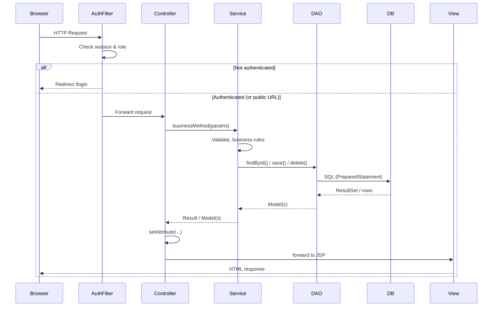

# Future MVC Architecture — Target State
## Airport Lounge Manager (ALM)

**Purpose:** This document describes the **complete MVC architecture** when all planned features are implemented. It is the target/final design, not the current state.

---

## 1. Architecture Overview

The application follows a **layered MVC** pattern:

- **Presentation:** Browser → **Filter** (Auth) → **Controllers (Servlets)** → **Views (JSP)**
- **Business:** **Services** (validation, workflows, orchestration)
- **Data:** **DAOs** → **DBConnection** → **MySQL (`alm`)**
- **Domain:** **Models** (entities) used across layers

```
┌─────────────────────────────────────────────────────────────────────────────┐
│                              BROWSER (User)                                  │
└─────────────────────────────────────────────────────────────────────────────┘
                    │
                    ▼
┌─────────────────────────────────────────────────────────────────────────────┐
│  FILTER LAYER                                                                │
│  AuthFilter → session check, role check → redirect to /login if not allowed  │
└─────────────────────────────────────────────────────────────────────────────┘
                    │
                    ▼
┌─────────────────────────────────────────────────────────────────────────────┐
│  CONTROLLER LAYER (Servlets)                                                 │
│  LoginServlet, LogoutServlet, DashboardServlet, AirportServlet, ...          │
│  • Parse request (params, session)                                           │
│  • Call Service layer                                                        │
│  • Set request attributes / redirect / forward to View                      │
└─────────────────────────────────────────────────────────────────────────────┘
                    │                                    │
                    │                                    │ forward / redirect
                    ▼                                    ▼
┌──────────────────────────────────────┐    ┌─────────────────────────────────┐
│  SERVICE LAYER                        │    │  VIEW LAYER (JSP)                │
│  AuthService, AirportService,         │    │  login.jsp, dashboard.jsp,        │
│  LoungeService, PassengerService,     │    │  airport-list.jsp, ...             │
│  AccessRequestService, ...            │    │  • Render HTML with request attrs  │
│  • Business rules, validation         │    └─────────────────────────────────┘
│  • Orchestrate DAOs                   │
└──────────────────────────────────────┘
                    │
                    ▼
┌─────────────────────────────────────────────────────────────────────────────┐
│  DAO LAYER (Data Access)                                                     │
│  UserDAO, AirportDAO, LoungeDAO, PassengerDAO, AccessRequestDAO, ...          │
│  • CRUD via JDBC (PreparedStatement)                                          │
│  • Map ResultSet → Model                                                      │
└─────────────────────────────────────────────────────────────────────────────┘
                    │
                    ▼
┌─────────────────────────────────────────────────────────────────────────────┐
│  DBConnection → MySQL Database: alm                                          │
│  Tables: users, airports, lounges, passengers, access_providers,             │
│          access_requests, transactions, staff, passenger_memberships,        │
│          occupancy_logs, audit_logs                                           │
└─────────────────────────────────────────────────────────────────────────────┘
```

---

## 2. High-Level MVC Diagram (Target State)

```mermaid
flowchart TB
  subgraph Presentation["Presentation Layer"]
    direction TB
    subgraph Controllers["Controllers (Servlets)"]
      LoginServlet["LoginServlet<br/>/login"]
      LogoutServlet["LogoutServlet<br/>/logout"]
      DashboardServlet["DashboardServlet<br/>/dashboard"]
      AirportServlet["AirportServlet<br/>/airports"]
      LoungeServlet["LoungeServlet<br/>/lounges"]
      PassengerServlet["PassengerServlet<br/>/passengers"]
      AccessRequestServlet["AccessRequestServlet<br/>/access-requests"]
      AccessProviderServlet["AccessProviderServlet<br/>/access-providers"]
      StaffServlet["StaffServlet<br/>/staff"]
      TransactionServlet["TransactionServlet<br/>/transactions"]
      OccupancyServlet["OccupancyServlet<br/>/occupancy"]
      MembershipServlet["MembershipServlet<br/>/memberships"]
      AuditLogServlet["AuditLogServlet<br/>/audit-logs"]
      UserServlet["UserServlet<br/>/users"]
      ReportServlet["ReportServlet<br/>/reports"]
      ProfileServlet["ProfileServlet<br/>/profile"]
      SettingsServlet["SettingsServlet<br/>/settings"]
    end
    subgraph Views["Views (JSP)"]
      index["index.jsp"]
      login["login.jsp"]
      dashboard["dashboard.jsp"]
      error["error.jsp"]
      status["status.jsp"]
      airport_list["airport-list.jsp"]
      airport_form["airport-form.jsp"]
      airport_view["airport-view.jsp"]
      lounge_list["lounge-list.jsp"]
      lounge_form["lounge-form.jsp"]
      lounge_view["lounge-view.jsp"]
      passenger_list["passenger-list.jsp"]
      passenger_form["passenger-form.jsp"]
      passenger_view["passenger-view.jsp"]
      request_list["access-request.jsp"]
      request_view["access-request-view.jsp"]
      provider_list["provider-list.jsp"]
      provider_form["provider-form.jsp"]
      staff_list["staff-list.jsp"]
      staff_form["staff-form.jsp"]
      staff_view["staff-view.jsp"]
      trans_list["transaction-list.jsp"]
      trans_view["transaction-view.jsp"]
      occupancy_dash["occupancy-dashboard.jsp"]
      occupancy_history["occupancy-history.jsp"]
      membership_list["membership-list.jsp"]
      membership_form["membership-form.jsp"]
      audit_list["audit-log-list.jsp"]
      user_list["user-list.jsp"]
      user_form["user-form.jsp"]
      reports_dash["reports-dashboard.jsp"]
      revenue_report["revenue-report.jsp"]
      occupancy_report["occupancy-report.jsp"]
      access_report["access-report.jsp"]
      profile_page["profile.jsp"]
      settings_page["settings.jsp"]
    end
  end

  subgraph Business["Business Layer"]
    AuthService["AuthService"]
    AirportService["AirportService"]
    LoungeService["LoungeService"]
    PassengerService["PassengerService"]
    AccessRequestService["AccessRequestService"]
    AccessProviderService["AccessProviderService"]
    StaffService["StaffService"]
    TransactionService["TransactionService"]
    OccupancyService["OccupancyService"]
    MembershipService["MembershipService"]
    AuditLogService["AuditLogService"]
    UserService["UserService"]
    ReportService["ReportService"]
    DashboardService["DashboardService"]
  end

  subgraph Data["Data Access Layer"]
    UserDAO["UserDAO"]
    AirportDAO["AirportDAO"]
    LoungeDAO["LoungeDAO"]
    PassengerDAO["PassengerDAO"]
    AccessRequestDAO["AccessRequestDAO"]
    AccessProviderDAO["AccessProviderDAO"]
    StaffDAO["StaffDAO"]
    TransactionDAO["TransactionDAO"]
    OccupancyDAO["OccupancyDAO"]
    MembershipDAO["MembershipDAO"]
    AuditLogDAO["AuditLogDAO"]
  end

  subgraph Models["Models (Domain)"]
    User["User"]
    Airport["Airport"]
    Lounge["Lounge"]
    Passenger["Passenger"]
    AccessRequest["AccessRequest"]
    AccessProvider["AccessProvider"]
    Staff["Staff"]
    Transaction["Transaction"]
    OccupancyLog["OccupancyLog"]
    Membership["Membership"]
    AuditLog["AuditLog"]
  end

  subgraph DB["Database: alm"]
    tables[(users, airports, lounges, passengers,<br/>access_providers, access_requests, transactions,<br/>staff, passenger_memberships, occupancy_logs, audit_logs)]
  end

  Controllers --> Views
  Controllers --> Business
  Business --> Models
  Business --> Data
  Data --> Models
  Data --> DB
```



---

## 3. Request Flow (Generic)



---

## 4. Complete Controller → Service → DAO → Model Mapping (Target)

| Controller (Servlet) | URL(s) | Service | DAO | Main Model(s) |
|----------------------|--------|---------|-----|----------------|
| LoginServlet | GET/POST /login | AuthService | UserDAO | User |
| LogoutServlet | GET /logout | — | — | — |
| DashboardServlet | GET /dashboard | DashboardService | Multiple | — |
| AirportServlet | /airports, /airports/add, /airports/edit, /airports/view | AirportService | AirportDAO | Airport |
| LoungeServlet | /lounges, /lounges/add, /lounges/edit, /lounges/view | LoungeService | LoungeDAO | Lounge |
| PassengerServlet | /passengers, /passengers/add, /passengers/edit, /passengers/view | PassengerService | PassengerDAO | Passenger |
| AccessRequestServlet | /access-requests, /access-requests/view, approve, reject | AccessRequestService | AccessRequestDAO | AccessRequest |
| AccessProviderServlet | /access-providers, add, edit | AccessProviderService | AccessProviderDAO | AccessProvider |
| StaffServlet | /staff, add, edit, view | StaffService | StaffDAO | Staff |
| TransactionServlet | /transactions, view, refund | TransactionService | TransactionDAO | Transaction |
| OccupancyServlet | /occupancy, /occupancy/history | OccupancyService | OccupancyDAO | OccupancyLog |
| MembershipServlet | /memberships, add, edit | MembershipService | MembershipDAO | Membership |
| AuditLogServlet | /audit-logs | AuditLogService | AuditLogDAO | AuditLog |
| UserServlet | /users, add, edit (admin) | UserService | UserDAO | User |
| ReportServlet | /reports, /reports/revenue, occupancy, access | ReportService | Multiple | — |
| ProfileServlet | /profile | AuthService / UserService | UserDAO | User |
| SettingsServlet | /settings (admin) | AppConfig / SettingsService | — | — |

---

## 5. Complete View (JSP) List — Target

### Public
- `index.jsp` — Home
- `login.jsp` — Login form
- `status.jsp` — Connection status
- `error.jsp` — Error page (404, 500)

### Protected — Core
- `dashboard.jsp` — Main dashboard (real-time stats)
- `passenger-list.jsp` — List passengers
- `passenger-form.jsp` — Add/Edit passenger
- `passenger-view.jsp` — View passenger details
- `access-request.jsp` — List access requests
- `access-request-view.jsp` — View request details

### Protected — Airports & Lounges
- `airport-list.jsp` — List airports
- `airport-form.jsp` — Add/Edit airport
- `airport-view.jsp` — View airport + lounges
- `lounge-list.jsp` — List lounges
- `lounge-form.jsp` — Add/Edit lounge
- `lounge-view.jsp` — View lounge + occupancy

### Protected — Providers, Staff, Transactions
- `provider-list.jsp` — List access providers
- `provider-form.jsp` — Add/Edit provider
- `staff-list.jsp` — List staff
- `staff-form.jsp` — Add/Edit staff
- `staff-view.jsp` — View staff
- `transaction-list.jsp` — List transactions
- `transaction-view.jsp` — View transaction

### Protected — Occupancy & Memberships
- `occupancy-dashboard.jsp` — Real-time occupancy
- `occupancy-history.jsp` — Occupancy history
- `membership-list.jsp` — List memberships
- `membership-form.jsp` — Add/Edit membership

### Protected — Admin & Reports
- `audit-log-list.jsp` — Audit logs
- `user-list.jsp` — List users (admin)
- `user-form.jsp` — Add/Edit user (admin)
- `reports-dashboard.jsp` — Reports home
- `revenue-report.jsp` — Revenue report
- `occupancy-report.jsp` — Occupancy report
- `access-report.jsp` — Access report
- `profile.jsp` — User profile
- `settings.jsp` — App settings (admin)

---

## 6. Complete Model (Domain) List — Target

| Model Class | Table | Purpose |
|-------------|--------|---------|
| User | users | Login, roles, profile |
| Airport | airports | Airport master |
| Lounge | lounges | Lounge master (linked to Airport) |
| Passenger | passengers | Passenger master |
| AccessProvider | access_providers | Provider type (AIRLINE, CREDIT_CARD, AGGREGATOR) |
| AccessRequest | access_requests | Access request with status, decision |
| Transaction | transactions | Payment/refund linked to request |
| Staff | staff | Staff per airport, role |
| Membership | passenger_memberships | Passenger membership per provider |
| OccupancyLog | occupancy_logs | Snapshot of lounge occupancy |
| AuditLog | audit_logs | Audit trail (staff_id, action, entity) |

Optional DTOs for reports: `RevenueSummary`, `OccupancySummary`, `AccessReportRow`, etc.

---

## 7. Complete Service List — Target

| Service | Responsibility |
|---------|----------------|
| AuthService | Login, logout, password verify, profile |
| DashboardService | Aggregate stats (capacity, pending, revenue) |
| AirportService | CRUD airports, validation (IATA) |
| LoungeService | CRUD lounges, occupancy summary |
| PassengerService | CRUD passengers, link to memberships |
| AccessRequestService | List, view, approve, reject, decision reason |
| AccessProviderService | CRUD access providers |
| StaffService | CRUD staff, assign airport/role |
| TransactionService | List, view, process payment, refund |
| OccupancyService | Current occupancy, history, trends |
| MembershipService | CRUD memberships, validity |
| AuditLogService | Write log, list/filter logs (read-only) |
| UserService | CRUD users (admin), reset password |
| ReportService | Revenue, occupancy, access reports |

---

## 8. Complete DAO List — Target

| DAO | Table(s) | Main Operations |
|-----|----------|------------------|
| UserDAO | users | findByUsername, findById, create, update |
| AirportDAO | airports | findAll, findById, save, update, toggleActive |
| LoungeDAO | lounges | findAll, findByAirport, findById, save, update |
| PassengerDAO | passengers | findAll, findById, save, update, search |
| AccessRequestDAO | access_requests | findAll, findById, save, updateStatus |
| AccessProviderDAO | access_providers | findAll, findById, save, update |
| StaffDAO | staff | findAll, findByAirport, findById, save, update |
| TransactionDAO | transactions | findAll, findById, findByRequest, save, updateStatus |
| OccupancyDAO | occupancy_logs | getCurrentByLounge, getHistory, insert |
| MembershipDAO | passenger_memberships | findAll, findByPassenger, findById, save, update |
| AuditLogDAO | audit_logs | insert, findAll (filter by staff, date, entity) |

---

## 9. Filter (Target)

| Filter | URL Pattern | Action |
|--------|-------------|--------|
| AuthFilter | /dashboard, /passengers, /airports, /lounges, /access-requests, /access-providers, /staff, /transactions, /occupancy, /memberships, /audit-logs, /users, /reports, /profile, /settings | If no session → redirect to /login. Optionally check role and return 403 or redirect. |
| (Excluded) | /login, /logout, /, /status.jsp, /assets/* | No auth required. |

---

## 10. Final Package & File Structure (Target)

```
src/main/java/com/alm/
├── filter/
│   └── AuthFilter.java
├── controller/
│   ├── LoginServlet.java
│   ├── LogoutServlet.java
│   ├── DashboardServlet.java
│   ├── AirportServlet.java
│   ├── LoungeServlet.java
│   ├── PassengerServlet.java
│   ├── AccessRequestServlet.java
│   ├── AccessProviderServlet.java
│   ├── StaffServlet.java
│   ├── TransactionServlet.java
│   ├── OccupancyServlet.java
│   ├── MembershipServlet.java
│   ├── AuditLogServlet.java
│   ├── UserServlet.java
│   ├── ReportServlet.java
│   ├── ProfileServlet.java
│   └── SettingsServlet.java
├── service/
│   ├── AuthService.java
│   ├── DashboardService.java
│   ├── AirportService.java
│   ├── LoungeService.java
│   ├── PassengerService.java
│   ├── AccessRequestService.java
│   ├── AccessProviderService.java
│   ├── StaffService.java
│   ├── TransactionService.java
│   ├── OccupancyService.java
│   ├── MembershipService.java
│   ├── AuditLogService.java
│   ├── UserService.java
│   └── ReportService.java
├── dao/
│   ├── UserDAO.java
│   ├── AirportDAO.java
│   ├── LoungeDAO.java
│   ├── PassengerDAO.java
│   ├── AccessRequestDAO.java
│   ├── AccessProviderDAO.java
│   ├── StaffDAO.java
│   ├── TransactionDAO.java
│   ├── OccupancyDAO.java
│   ├── MembershipDAO.java
│   └── AuditLogDAO.java
├── model/
│   ├── User.java
│   ├── Airport.java
│   ├── Lounge.java
│   ├── Passenger.java
│   ├── AccessRequest.java
│   ├── AccessProvider.java
│   ├── Staff.java
│   ├── Transaction.java
│   ├── Membership.java
│   ├── OccupancyLog.java
│   └── AuditLog.java
├── util/
│   ├── DBConnection.java
│   ├── PasswordUtil.java
│   └── LoggerUtil.java
└── config/
    └── AppConfig.java

src/main/webapp/
├── index.jsp
├── status.jsp
├── WEB-INF/
│   ├── web.xml
│   └── views/
│       ├── login.jsp
│       ├── dashboard.jsp
│       ├── error.jsp
│       ├── passenger-list.jsp
│       ├── passenger-form.jsp
│       ├── passenger-view.jsp
│       ├── access-request.jsp
│       ├── access-request-view.jsp
│       ├── airport-list.jsp
│       ├── airport-form.jsp
│       ├── airport-view.jsp
│       ├── lounge-list.jsp
│       ├── lounge-form.jsp
│       ├── lounge-view.jsp
│       ├── provider-list.jsp
│       ├── provider-form.jsp
│       ├── staff-list.jsp
│       ├── staff-form.jsp
│       ├── staff-view.jsp
│       ├── transaction-list.jsp
│       ├── transaction-view.jsp
│       ├── occupancy-dashboard.jsp
│       ├── occupancy-history.jsp
│       ├── membership-list.jsp
│       ├── membership-form.jsp
│       ├── audit-log-list.jsp
│       ├── user-list.jsp
│       ├── user-form.jsp
│       ├── reports-dashboard.jsp
│       ├── revenue-report.jsp
│       ├── occupancy-report.jsp
│       ├── access-report.jsp
│       ├── profile.jsp
│       └── settings.jsp
└── assets/
    └── css/
        └── style.css
```

---

## 11. Database (alm) — Tables Used in MVC

| Table | Model | DAO |
|-------|--------|-----|
| users | User | UserDAO |
| airports | Airport | AirportDAO |
| lounges | Lounge | LoungeDAO |
| passengers | Passenger | PassengerDAO |
| access_providers | AccessProvider | AccessProviderDAO |
| access_requests | AccessRequest | AccessRequestDAO |
| transactions | Transaction | TransactionDAO |
| staff | Staff | StaffDAO |
| passenger_memberships | Membership | MembershipDAO |
| occupancy_logs | OccupancyLog | OccupancyDAO |
| audit_logs | AuditLog | AuditLogDAO |

Views (v_active_*) can be used by DAOs for read-only lists where only active records are needed.

---

## 12. Summary: What We Will Have When Complete

- **1** Auth filter (session + optional role).
- **17** Controllers (Servlets) covering login, logout, dashboard, airports, lounges, passengers, access requests, providers, staff, transactions, occupancy, memberships, audit logs, users, reports, profile, settings.
- **~40** JSP views (lists, forms, views, reports, profile, settings).
- **11** Domain models aligned with DB tables.
- **14** Services for business logic and orchestration.
- **11** DAOs for database access.
- **1** Database (`alm`) with 11 tables and 5 views.

This document is the **target MVC architecture**; implement in phases (e.g. Phase 1: Airports, Lounges, Passengers, Access Requests) as in PAGES_LIST.md.
