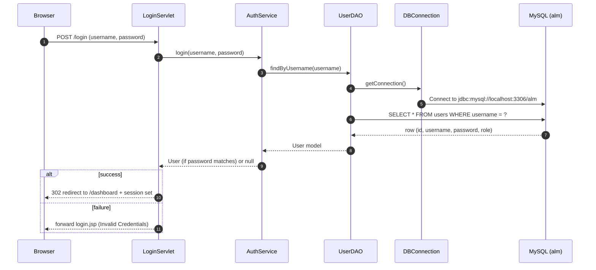

# MVC Diagram (Airport Lounge Manager)

This project follows an **MVC-style** structure:

- **Controller**: Java Servlets in `src/main/java/com/alm/controller/`
- **View**: JSP pages in `src/main/webapp/` and `src/main/webapp/WEB-INF/views/`
- **Model**: Domain objects in `src/main/java/com/alm/model/`
- **Data layer (Model-support)**: DAOs in `src/main/java/com/alm/dao/` and DB utilities in `src/main/java/com/alm/util/`
- **Business layer (Model-support)**: Services in `src/main/java/com/alm/service/`

---

## High-level MVC diagram

```mermaid
flowchart LR
  U[User / Browser]

  subgraph C[Controller (Servlets)]
    LoginS[LoginServlet<br/>/login]
    DashS[DashboardServlet<br/>/dashboard]
    PassS[PassengerServlet<br/>/passengers]
    ReqS[AccessRequestServlet<br/>/access-requests]
    LogoutS[LogoutServlet<br/>/logout]
  end

  subgraph V[Views (JSP)]
    IndexV[index.jsp]
    LoginV[WEB-INF/views/login.jsp]
    DashV[WEB-INF/views/dashboard.jsp]
    PassV[WEB-INF/views/passenger-list.jsp]
    ReqV[WEB-INF/views/access-request.jsp]
    ErrV[WEB-INF/views/error.jsp]
    StatusV[status.jsp]
  end

  subgraph S[Service Layer]
    AuthSvc[AuthService]
    PassSvc[PassengerService]
    LoungeSvc[LoungeService]
    TxSvc[TransactionService]
  end

  subgraph D[DAO / Data Access]
    UserDAO[UserDAO]
    PassDAO[PassengerDAO]
    LoungeDAO[LoungeDAO]
    TxDAO[TransactionDAO]
  end

  subgraph M[Models]
    UserM[User]
    PassengerM[Passenger]
    LoungeM[Lounge]
    RequestM[AccessRequest]
    TxM[Transaction]
  end

  subgraph DB[(MySQL Database: alm)]
    UsersT[users]
    OtherT[(other tables...)]
  end

  U -->|GET /| IndexV
  U -->|GET /status.jsp| StatusV
  U -->|GET /login| LoginS --> LoginV
  U -->|POST /login| LoginS --> AuthSvc --> UserDAO --> DB
  U -->|GET /dashboard| DashS --> DashV
  U -->|GET /passengers| PassS --> PassV
  U -->|GET /access-requests| ReqS --> ReqV
  U -->|GET /logout| LogoutS -->|redirect /login| LoginS

  UserDAO --- UsersT
  PassDAO --- OtherT
  LoungeDAO --- OtherT
  TxDAO --- OtherT

  AuthSvc --- UserM
  PassSvc --- PassengerM
  LoungeSvc --- LoungeM
  TxSvc --- TxM
```

---

## Login request flow (detailed)



---

## MVC mapping to your code

### Controllers
- `src/main/java/com/alm/controller/LoginServlet.java`
- `src/main/java/com/alm/controller/DashboardServlet.java`
- `src/main/java/com/alm/controller/PassengerServlet.java`
- `src/main/java/com/alm/controller/AccessRequestServlet.java`
- `src/main/java/com/alm/controller/LogoutServlet.java`

### Views
- `src/main/webapp/index.jsp`
- `src/main/webapp/status.jsp`
- `src/main/webapp/WEB-INF/views/login.jsp`
- `src/main/webapp/WEB-INF/views/dashboard.jsp`
- `src/main/webapp/WEB-INF/views/passenger-list.jsp`
- `src/main/webapp/WEB-INF/views/access-request.jsp`
- `src/main/webapp/WEB-INF/views/error.jsp`

### Models
- `src/main/java/com/alm/model/User.java`
- `src/main/java/com/alm/model/Passenger.java`
- `src/main/java/com/alm/model/Lounge.java`
- `src/main/java/com/alm/model/AccessRequest.java`
- `src/main/java/com/alm/model/Transaction.java`

### Services (business rules)
- `src/main/java/com/alm/service/AuthService.java`
- `src/main/java/com/alm/service/PassengerService.java`
- `src/main/java/com/alm/service/LoungeService.java`
- `src/main/java/com/alm/service/TransactionService.java`

### DAOs (database access)
- `src/main/java/com/alm/dao/UserDAO.java` (DB-backed)
- `src/main/java/com/alm/dao/PassengerDAO.java` (mock currently)
- `src/main/java/com/alm/dao/LoungeDAO.java` (mock currently)
- `src/main/java/com/alm/dao/TransactionDAO.java` (placeholder currently)

### DB utilities
- `src/main/java/com/alm/util/DBConnection.java` (connects to MySQL `alm`)
- `src/main/java/com/alm/util/PasswordUtil.java` (password hashing/verification)

